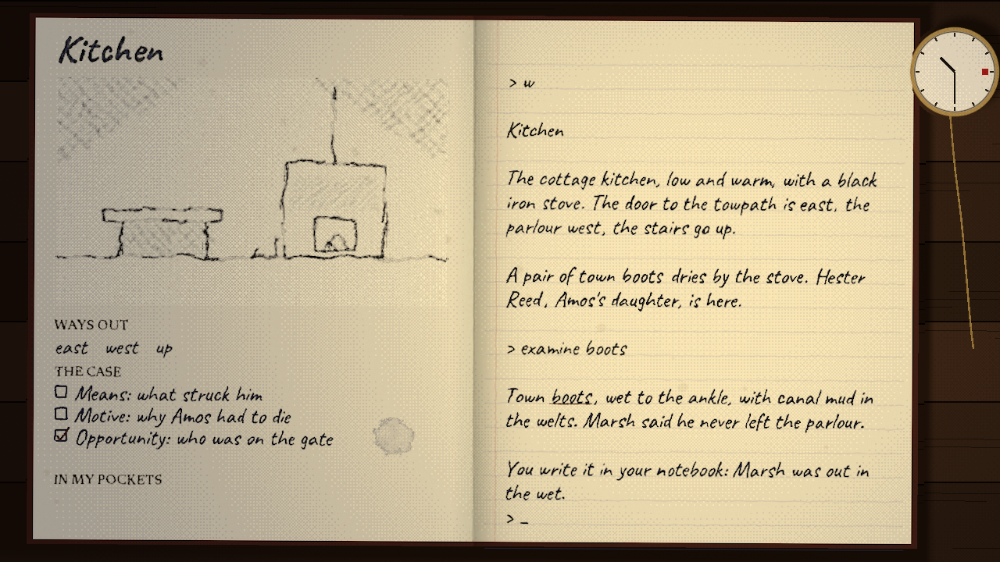
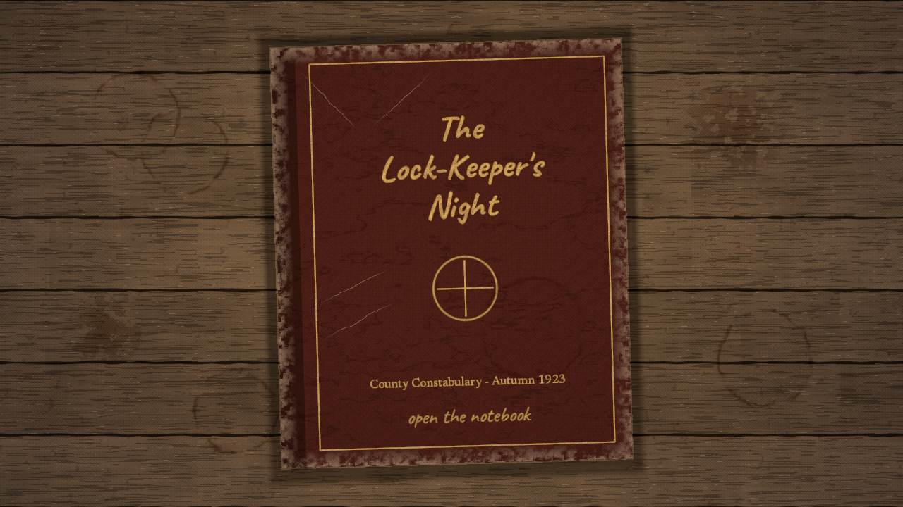
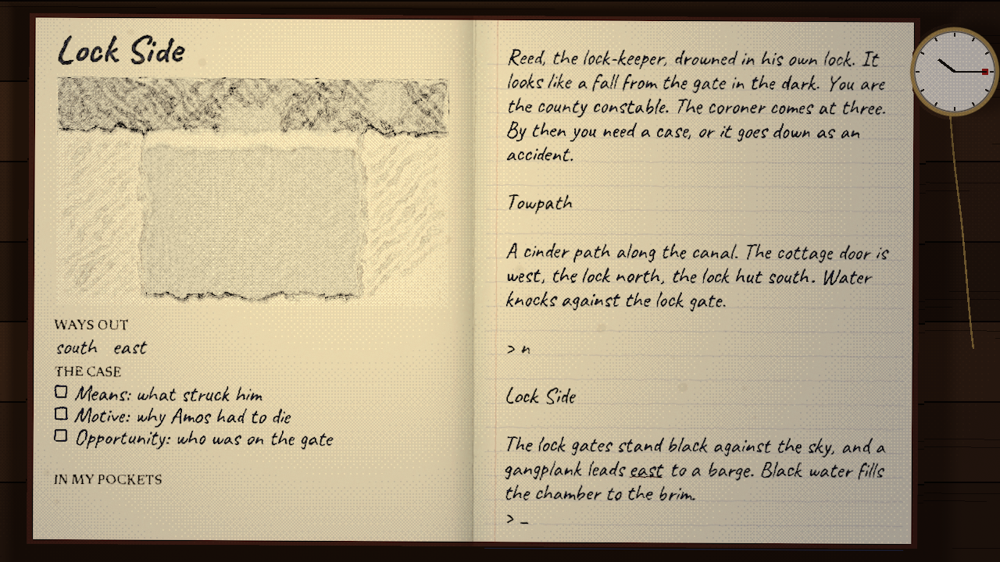
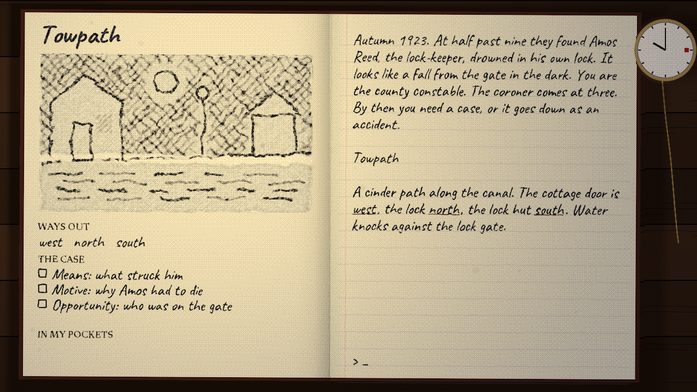
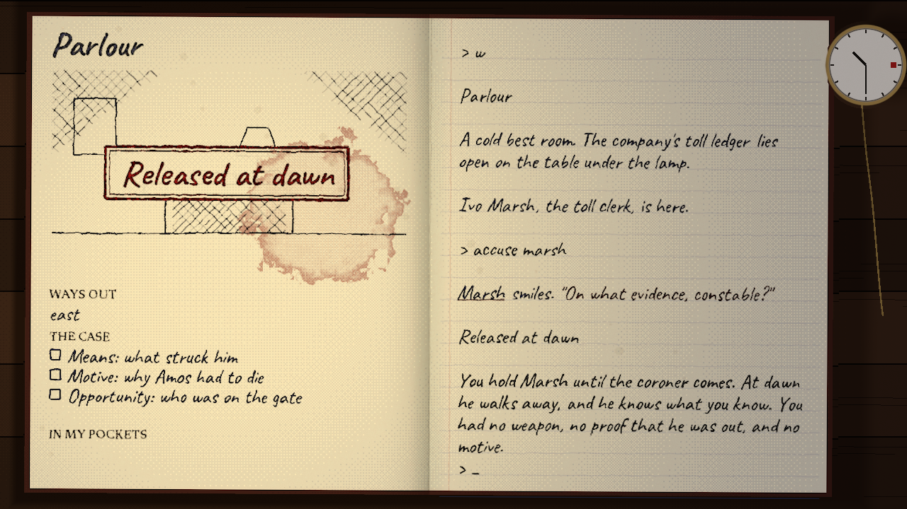

# The Lock-Keeper's Night

Autumn 1923: Amos Reed, the lock-keeper, lies drowned in his own lock, you are the county constable, and the coroner comes at three. This is an interactive fiction game in Rust, played inside the constable's notebook by candlelight.



The story is the demo that ships with [loremaster](https://github.com/sunsided/loremaster), where it is plain text in a terminal; this repository is what happens when you give it a desk, a candle and rather too many shaders. It runs on [game-toolkit](https://github.com/sunsided/game-toolkit), natively and in the browser.

**Play it in the browser:** <https://games.markusmayer.dev/lock-keeper/> or <https://sunsided.github.io/lock-keeper/>

## Playing

Natively, you need a Rust toolchain (1.95 or newer) and a GPU that wgpu is happy with:

```sh
cargo run --release
```

Prove means, opportunity and motive against the right person before three o'clock, or the death goes down as an accident. Type commands (`examine boots`, `open lower paddles`, `talk to crane`, `accuse <person>`), or click the underlined words: a verb waits on the input row for its noun, a thing gets examined, and an exit gets walked. `hint`, `journal` and `undo` do what they say.

Enter or a click finishes the sentence the pen is writing, PageUp and the mouse wheel read back, and the mouse carries the candle.

| | |
|---|---|
|  |  |
|  |  |

## What's on the page

The right page is the transcript, written out by the pen in ink that dries as you read. The left page has a sketch of the room, drawn once when you arrive and left alone after that (the stove fire and the barge's lamp being the exceptions), along with the exits, the three proofs of the case, and what's in your pockets. A pocket watch on the desk counts down to the coroner, and the candle's reach shrinks with it, though never so far that the page becomes unreadable.

Most of the look comes from three full-screen passes in WGSL:

- [`src/ink.wgsl`](src/ink.wgsl) is the ink. It ports the `ink-bleed` recipe from [web-visual-fx](https://github.com/sunsided/web-visual-fx) to a single pass: the picture wanders along paper fibers, gets blurred and soft-stepped back to an edge, and the pigment pools at the rim. It works on the transmittance against the paper color, so the paper needs no layer of its own. Finding a proof, an hour striking, and the verdict each bloom a stain.
- [`src/cover.wgsl`](src/cover.wgsl) paints the title screen: the desk, the tea rings, and the worn leather of the book.
- The `LANTERN` shader in [`src/main.rs`](src/main.rs) is the candle. Shadows come from following the ray from each desk pixel up towards the flame, 300 px above the desk, and checking whether the book or the watch is in the way at their height; the pages turn towards or away from the flame near the spine. The falloff is an ordered Bayer dither, which is also applied to the washes and stains but not to the letters.

Text is drawn with baked bitmap fonts (see [`tools/bake_fonts.py`](tools/bake_fonts.py)), since the toolkit's TrueType path always uses the default family.

## Bundling

The native binary needs no files next to it. `build.rs` compiles [`story/`](story) into a JSON bundle, so a broken story fails the build, and generates the [Treaty of Babel](https://babel.ifarchive.org/babel.html) metadata through [ifiction](https://github.com/sunsided/ifiction), which embeds the iFiction record and the cover (this is the first game to use it):

```sh
lock-keeper --ifid       # the IFID
lock-keeper --ifiction   # the whole record
```

The web build carries its own IFID, as a port to another format should: `build.rs` picks it by target, and `index.html` has it in the `ifiction:ifid` meta tag.

loremaster is still in flux and not released, so the crates are pinned to a commit in `Cargo.toml`, and `story/` is the copy of the demo that matches it.

## Status

Playable from start to any of the five endings, with a few things missing: there are no save games (`undo` goes back 20 steps) and no sound, and it has only been run on Linux with one GPU. At window sizes above 1280x720 the canvas gets upscaled, so text turns a little soft.

[go-task](https://taskfile.dev) wraps the usual commands; `task` lists them, and `task check` runs formatting, clippy, and the tests.

## Credits and license

The handwriting is [Caveat](https://fonts.google.com/specimen/Caveat) and the print is [Newsreader](https://fonts.google.com/specimen/Newsreader), both under the SIL Open Font License (see [`assets/fonts`](assets/fonts)).

Licensed under the [EUPL-1.2](LICENSE).
